# Human-in-the-loop with LiveKit Portal and reBot B601

This tutorial builds a human-in-the-loop (HITL) training pipeline with
[LiveKit Portal](https://github.com/livekit/portal) and a Seeed reBot Arm B601-DM.
Let a policy attempt a task, take over with a leader arm when it needs help,
and record the correction. Use those recordings to train a policy, then repeat.

A reBot 102 leader arm controls the follower over a LiveKit room. An ACT policy
trained on your takes joins as another operator. A separate observer records state, arm and overhead video, actions, and
episode markers to a Rerun archive; Portal converts that archive into a LeRobot
v3 dataset for training.

<picture>
  <source media="(prefers-color-scheme: dark)" srcset="tutorial/images/hitl-loop-dark.svg">
  
</picture>

## The tutorial

Read the chapters in order to build the loop, one Portal concept at a time.

| Chapter | What you’ll learn |
|---|---|
| [00. What is Portal?](tutorial/00-what-is-portal.md) | Robot, operator, and observer roles in a HITL session |
| [01. Wire contract](tutorial/01-wire-contract.md) | Share camera, state, and action schemas across peers |
| [02. Robot loop](tutorial/02-robot-loop.md) | Publish observations and apply accepted actions |
| [03. Operator loop](tutorial/03-operator-loop.md) | Read the leader, display video, and anchor actions |
| [04. HITL recording](tutorial/04-hitl-recording.md) | Record both operators and build a training dataset |
| [05. Handoff](tutorial/05-handoff.md) | Switch between human and policy without ending a take |
| [06. Plugging in a policy](tutorial/06-plugging-in-policies.md) | Run ACT as a Portal operator |
| [07. Running the rig](tutorial/07-running-the-rig.md) | Set up, collect, train, run inference, and record corrections |

For the commands to run the full loop, start with
[07. Running the rig](tutorial/07-running-the-rig.md).

## What you can use this example for

- **Collect demonstrations and recoveries.** Demonstrate a whole task with the
  leader arm, or take over after a missed grasp and let the policy continue.
  Recording spans the handoff so the take includes the attempt and correction.
- **Train a policy for your setup.** Review the takes, convert them to a LeRobot
  dataset, and train ACT (Action Chunking with Transformers) on your own camera
  views and joint actions. Run the checkpoint and collect more corrections.
- **Try another policy through the same interface.** Any model that reads
  Portal observations and sends actions can take ACT’s place.

## Layout

```text
portal.yaml             # shared camera, state, and action schema
src/
  robot.py              # publish observations and apply actions
  teleoperator.py       # leader arm, handoff, and episode markers
  recorder.py           # observer writing session archives
  _common.py            # environment, tokens, and pacing
  utils/                # hardware, hotkeys, preview, and task prompts
  policies/act/         # train.py, inference.py, skypilot.yaml
tutorial/               # the HITL walkthrough
scripts/                # deployment helper
test/                   # hardware-free checks
```

## Requirements at a glance

- A LiveKit server with URL, API key, and API secret.
- A B601-DM follower with an arm camera and an overhead camera, and a reBot 102 leader arm.
- Python 3.12 and `uv`.
- Disk space for recording and a CUDA machine for training ACT.

The walkthrough uses Portal 0.3’s observer recorder and offline converter.
There is no CLI framework: run `uv run robot`, `uv run teleoperator`, and `uv run recorder`.
See [test/README.md](test/README.md) for hardware-free checks.
