# 0. What is Portal?

Imagine a policy trying to pick up a cube. It misses, so you take control,
correct the motion, and let it try again. Recording those corrections gives
you new demonstrations to train on. That is the human-in-the-loop cycle we’ll
build here.

Portal connects the robot, human operator, policy, and recorder through a
LiveKit room. They can run on different machines. You supply the hardware and
model code; Portal carries observations and actions and decides which operator
may control the robot.

## Three roles, five processes

| Process | Portal role | What it does |
|---|---|---|
| `uv run src/robot.py` | Robot | Publishes joint state and wrist video; applies accepted actions |
| `uv run src/teleoperator.py` | Operator | Reads the leader arm and lets you switch control |
| `src/policies/dream1/inference.py` | Operator | Produces actions zero-shot from a task prompt with Dream-1 |
| `src/policies/act/inference.py` | Operator | Produces actions from an ACT checkpoint you train |
| `uv run src/recorder.py` | Observer | Records streams and episode markers without driving |

<picture>
  <source media="(prefers-color-scheme: dark)" srcset="images/hitl-room-dark.svg">
  
</picture>

The human and both policies use the same operator interface. The robot accepts actions
from one active operator at a time. Pressing `c` in teleop changes that operator;
you can switch during a take while the recorder continues writing.

## What we’ll build

First, we’ll define the state, action, and camera schema in `portal.yaml`.
Then we’ll follow an observation from the robot to an operator and an action
back to the robot. The action carries an observation timestamp so the recorder
can preserve what the operator was responding to.

Finally, we’ll plug in a policy as a second operator. Dream-1 runs zero-shot from
a task prompt, so you can test the loop before collecting any data. Then we’ll
convert recorded takes to a LeRobot dataset and train ACT on them. Human
corrections go into the same archive as policy actions, ready for another
training run.

The code snippets in these chapters show the relevant parts of the runnable
files, rather than standalone programs. Chapter 7 has the complete commands.

Next: [01. Wire contract](01-wire-contract.md).
