# 3. Operator loop

Open [`src/teleoperator.py`](../src/teleoperator.py).
The human operator receives video, reads the leader arm, and sends one action
per tick. It also controls handoff and marks episode boundaries.

## Show the incoming video

Each declared track registers an `on_video_frame` callback. The callback updates
`View` with the frame timestamp and passes decoded RGB pixels to `Preview`:

```python
view.saw(name, frame)
preview.show(name, frame_bytes_to_numpy_rgb(frame.data, frame.width, frame.height))
```

The preview keeps the latest image per camera. Session history belongs to the
recorder, so the display does not accumulate a second archive.

## Send an anchored action

```python
action = await hardware.run(leader.get_action)
op.send_action(action, in_reply_to_ts_us=view.anchor())
```

`View.anchor()` is the oldest of the latest camera timestamps, so it follows the
slower of the two views; it does not make their capture times simultaneous. It returns
`None` until all cameras have produced a frame.

<picture>
  <source media="(prefers-color-scheme: dark)" srcset="images/action-anchor-dark.svg">
  
</picture>

The anchor identifies the view available to the human. Using the latest state
timestamp instead could select state that arrived before its matching video.
Portal separately stamps when the action was sent using its robot-synchronized
clock.

## Claim control explicitly

Press `c` to claim control. Press it again to cycle to another connected
operator, such as `policy-act`. With only teleop connected, `c` selects teleop.
There is no background loop that reclaims the gate after you hand it away.

The leader keeps publishing while the policy drives, but the robot rejects
its actions until the human is active again. Chapter 5 follows this handoff.

## Mark a take

At startup, enter up to nine task descriptions. The hotkeys are:

| Key | Action |
|---|---|
| `c` | Claim or cycle control |
| `r` | Start or end a take |
| `[` | Discard the current take |
| `1`–`9` | Switch tasks between takes |
| `x` | Quit, discarding an open take |

Keys work globally where desktop permissions allow, and in the teleoperator’s
terminal as a fallback. Start the recorder before marking a take. A
`NOT RECORDED` message means the marker did not reach an observer.

Next: [04. HITL recording](04-hitl-recording.md).
