# 5. Handoff

HITL uses two operators in one room: the human and the policy. The robot’s
active-operator gate accepts only one sender at a time.

## Select the operator

The teleoperator’s `cycle_active_operator` builds a ring containing itself and
the other connected operators. Pressing `c` advances through that ring:

```python
ring = [me, *sorted(op.operators())]
current = op.active_operator()
target = ring[(ring.index(current) + 1) % len(ring)] if current in ring else me
await op.set_active_operator(target)
```

With teleop and ACT connected, the sequence is:

```text
no operator → teleoperator → policy-act → teleoperator → ...
```

The call is an RPC to the robot. If it fails, teleop reports the error; press
`c` again to retry. Neither operator claims control automatically.

## Record a correction

1. Start the robot, recorder, teleoperator, and ACT inference process.
2. Press `c` to select the human and position the arm.
3. Press `r` to start a take, then `c` to select ACT.
4. When the policy needs help, press `c` to take over and guide the leader.
5. Press `c` to return control to ACT, or `r` to finish the take.

<picture>
  <source media="(prefers-color-scheme: dark)" srcset="images/handoff-take-dark.svg">
  
</picture>

The recorder stays connected throughout. It captures accepted actions from
both senders, so the corrected trajectory can become another training episode.
Keep the leader near the follower’s pose before takeover to reduce the change
in commanded target.

## Clear old commands

The robot clears its action cache when the gate changes and releases the gate
when the active operator disconnects. ACT resets its action history when it
becomes active again. If control changes while inference is running, that
inference result is discarded.

The follower’s step limiter bounds changes to commanded targets. Clearing the
gate stops accepting new operator actions; it does not disable motor torque.

Next: [06. Plugging in a policy](06-plugging-in-policies.md).
